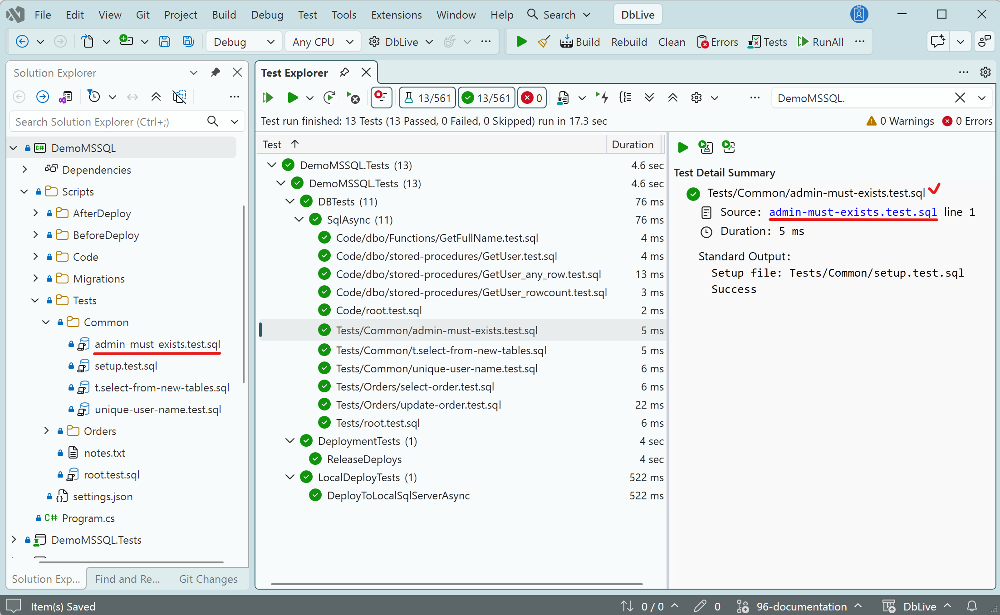

# DbLive

[](https://www.nuget.org/packages/DbLive)
[](https://github.com/zacoders/DbLive/actions/workflows/cicd.yml)
[](LICENSE)

**Database Lifecycle Management for .NET** — versioned migrations, code deployment, SQL unit tests, and safe rollback in one workflow.

DbLive treats the database as **versioned, testable, deployable code**. Use it when you want schema and SQL logic in source control, run as part of CI/CD, and roll back like any other release.

DbLive is built around one idea: the database is a **separate service** with its own interface, release cycle and tests, so it can be deployed without stopping the applications that use it. The model is optional: you can use DbLive as an ordinary migration tool and adopt the rest later.

> **The idea:** [Database as a Service](docs/database-as-service.md) explains the model, zero-downtime releases and the ways to use DbLive.
>
> **Using an AI coding assistant?** Give it [llms-full.txt](https://zacoders.github.io/DbLive/llms-full.txt): the complete reference in one file, written for agents (index: [llms.txt](https://zacoders.github.io/DbLive/llms.txt)).

---

## Safe by default

A deployment stops before any of your scripts runs when:

- **an older build is deployed by mistake**: the database has migrations the build lacks → `DowngradeNotAllowedException`, nothing changes. A rollback is deliberate: with `AllowDatabaseDowngrade = true` DbLive reverts those versions with the undo scripts stored in the database.
- **an applied migration was edited** → `MigrationChecksumMismatchException` (`MigrationChecksumMode` is `Strict` by default).
- **the database belongs to another project** → `ProjectIdMismatchException`, once the project sets `ProjectId` in `settings.json`.

Destructive changes run only in a separate breaking deployment (`DeployBreaking = true`). A deployment never runs SQL tests: they run in `dotnet test` against a disposable database.

## Status

Actively developed. Every merge to `main` is published to NuGet (the current version is on the badge above). Breaking changes come only in a major version, with the upgrade steps in the [release notes](https://github.com/zacoders/DbLive/releases); see the [versioning policy](docs/versioning.md). Targets .NET 8, 9 and 10; supports SQL Server, Azure SQL and PostgreSQL. License: [MIT](LICENSE).

---

## Features

| Area | Description |
|------|-------------|
| **Migrations** | Versioned schema changes with optional undo scripts; ordered, repeatable deployments. |
| **Code** | Deploy stored procedures, views, functions, and other code objects separately from migrations. |
| **SQL tests** | Write tests in SQL; run them as normal C#/xUnit tests in Visual Studio or CI, against a temporary database built from your scripts (Docker or a local server). |
| **Breaking changes** | Deploy breaking changes in a dedicated phase (e.g. after app rollout). |
| **Rollback** | Opt-in: deploy the previous build with `AllowDatabaseDowngrade = true`, and DbLive reverts the newer versions using the undo scripts stored in the database. Without it, an older build fails and changes nothing. |
| **CI/CD** | Works with GitHub Actions, Azure DevOps, TeamCity, Jenkins, or any build system that runs `dotnet`. |

---

## Quick start

### 1. Install packages

```bash
dotnet add package DbLive.MSSQL      # or DbLive.PostgreSQL; brings the DbLive package
dotnet add package DbLive.xunit      # for SQL unit tests
```

The DbLive package embeds all files in the `Scripts` folder in the project assembly when the project builds, so the dll you build is the dll you deploy. There is nothing to add to the `.csproj`.

### 2. Add SQL scripts to your project

Organize scripts in folders (names and layout are configurable):

```
Scripts/
  Migrations/
    001.migration.users_table.sql
    002.migration.orders_table.sql
    003.migration.new_indexes.sql
  Code/
    get_user_sp.sql
    get_user_sp.test.sql
    update_order_sp.sql
    update_order_sp.test.sql
  Tests/
    admin_must_exist.test.sql
    unique_user_name.test.sql
  settings.json
```

`settings.json` names the project, so the deployer of another project cannot deploy into its database ([ProjectId](docs/features/project-id.md)):

```json
{
  "ProjectId": "my-app-db"
}
```
### 3. Configure and run deployment
Microsoft SQL Server example:
```csharp
// Program.cs

using DbLive;
using DbLive.MSSQL;
using System.Reflection;

string dbCnnString = "Server=localhost;Database=DbLive_DemoMSSQL;Trusted_Connection=True;";

var builder = new DbLiveBuilder()
	.LogToConsole()
	.SqlServer()
	.SetDbConnection(dbCnnString)
	.SetProject(Assembly.GetExecutingAssembly());

await builder.CreateDeployer().DeployAsync(new DeployParameters
{
	CreateDbIfNotExists = true, // a local database; off by default, keep it off in production
	DeployCode = true,
	DeployMigrations = true
});
```

See the **Demo** projects in this repository (`src/Demo`) for full examples with MSSQL and PostgreSQL.

---

## Project structure

DbLive expects a clear separation of **migrations**, **code**, and **tests**. You can override folder names and patterns via `settings.json` next to your scripts.

| Folder | Purpose |
|--------|--------|
| **Migrations** | Schema and data changes in version order. Optional `*.undo.sql` per version for rollback, `*.breaking.sql` for breaking changes. |
| **Code** | Stored procedures, views, functions, etc. Paired `*.test.sql` files run as unit tests, paired `*.breaking.sql` files drop old object versions in the breaking phase. |
| **Tests** | Standalone SQL tests (e.g. cross-object checks, data rules). |
| **BeforeDeploy** / **AfterDeploy** | Scripts run on every deployment, before migrations or after breaking changes (optional; must be idempotent). |

Naming examples:

- Migrations: `001.migration.sql`, `002.migration.sql`, `002.undo.sql`
- Code: `GetUser.sql`, `GetUser.test.sql`
- Tests: `*.test.sql` or `t.*.sql` (patterns configurable)

---

## SQL testing

DbLive lets you **write tests in SQL** and run them as normal C# tests:

- In **Visual Studio** Test Explorer
- In **CI** (e.g. `dotnet test`)
- With the same tooling as the rest of your solution
- Against a **temporary database** built from your scripts, in Docker (Testcontainers) or on a local server, and dropped after the run: no shared test database to maintain

Use SQL tests to:

- Verify stored procedures and views
- Check data rules and constraints
- Validate migration outcomes

Tests are plain SQL. DbLive.xunit provides the `[SqlFact]` attribute and fixture so each `.test.sql` file becomes a test case.

### Test structure

Each `.test.sql` file is a standalone test with Arrange / Act / Assert sections:

```sql
-- Arrange
set identity_insert dbo.Users on;

insert into dbo.Users ( UserId, Name )
values ( 10, 'TestUser10' )

-- Act
exec dbo.GetUser2 @UserId = 10

-- Assert
select assert = 'rows'

select 10 as UserId, 'TestUser10' as Name
```

### Supported assertions

Assertions are defined by returning a result set with a column named `assert`.

| Assert | Description |
|--------|-------------|
| `rows` | Compare columns and row values with expected result sets; the number of result sets and rows must match too. |
| `rows-with-schema` | Compare columns, row values, and SQL types. |
| `has-rows` | Pass if at least one row is returned. |
| `row-count=N` | Pass if exactly N rows are returned. |
| `single-row` | Shortcut for `row-count=1`. |
| `empty` | Shortcut for `row-count=0`. |
| _(no assert)_ | Pass if script completes without error (you can use `THROW` for custom checks). |

Examples:

```sql
-- exact values
exec dbo.GetUser @UserId = 10
select assert = 'rows'
select 10 as UserId, 'TestUser10' as Name
```

```sql
-- row count
exec dbo.GetUser @UserId = -999
select assert = 'row-count=0'
```

```sql
-- type-aware comparison
select dbo.GetFullName('first', 'last')
select assert = 'rows-with-schema'
select cast('first last' as nvarchar(255))
```

```sql
-- custom assertion using throw
declare @cnt int = (
    select count(*)
    from dbo.Users
    where Name = 'Admin'
)

if @cnt != 1 throw 50000, 'Expected one admin user.', 0
```

### Shared test data with `setup.test.sql`

You can place `setup.test.sql` in any folder with tests, in `Tests` or next to code tests in `Code`. It is executed before each test in that folder, so one setup script can be reused by many tests. It is never a test itself and never deployed as code.

```text
Scripts/
  Tests/
    Orders/
      setup.test.sql
      select-order.test.sql
      update-order.test.sql
```

Example test that relies on the folder setup:

```sql
-- Arrange
-- Note: Test data was prepared in setup.test.sql file.

-- Act
select OrderId from dbo.Orders

-- Assert
select assert = 'row-count=3'
```

### Test isolation and rollback

Each SQL test runs inside a transaction. The transaction is always rolled back after test execution.

- `setup.test.sql` and the test script run in the same transaction.
- Test data is isolated between tests.
- No manual cleanup is needed.
- Tests are safe to re-run repeatedly.

> SQL becomes a first-class, testable citizen in your solution.



---

## Deployment flow

See [Database as a Service](docs/database-as-service.md) for why breaking changes run in a separate phase and how migrations, code, and applications fit together.

A single `DeployAsync` run typically does (in order):

1. **Checks** — `ProjectId`, settings, checksums of applied migrations
2. **Downgrade** — if the database has versions this build lacks: fails unless `AllowDatabaseDowngrade = true`, which runs their stored undo scripts, newest first
3. **BeforeDeploy** — run once-before scripts
4. **Migrations** — apply pending migrations in version order
5. **Code** — deploy or update code objects (procedures, views, etc.)
6. **Breaking changes** — breaking scripts of the code folder and of migrations (if enabled, and only after the code of this build is deployed)
7. **AfterDeploy** — run once-after scripts

You control what runs via `DeployParameters` (e.g. `DeployMigrations`, `DeployCode`, `DeployBreaking`, `AllowDatabaseDowngrade`). Presets like `DeployParameters.Default` and `DeployParameters.Breaking` are available.

SQL tests are not part of a deployment: they run as xUnit tests (`dotnet test`) against a disposable database, so a production deployer does not run them.

### Typical CI/CD pipeline

DbLive fits into a release pipeline like this:

1. **Build** — compile the solution
2. **Deploy database to Docker** — in a Docker database container (e.g. Testcontainers)
3. **Run tests** — `dotnet test`. It will run both C# and SQL tests.
4. **Deploy database** — migrations and code (DbLive)
5. **Deploy application** — new app version
6. **Drop old application** — remove previous app (if needed)
7. **Deploy breaking changes** — run DbLive with `DeployParameters.Breaking` when the old app is gone

The settings of a production deployment (`ProjectId`, database creation, downgrade, transactions, timeouts) are collected in [Production](docs/deployment/index.md#production).

---

## Supported databases

| Engine | Package | Status |
|--------|---------|--------|
| Microsoft SQL Server / Azure SQL | `DbLive.MSSQL` | Supported |
| PostgreSQL | `DbLive.PostgreSQL` | Supported |
| SQLite | — | Planned |
| MySQL | — | Planned |

---

## Design goals

DbLive design follows [zero-downtime, backward-compatible delivery](docs/database-as-service.md).

- **Database is not a special snowflake** — it is code: versioned in repo, reviewed, and deployed like application code.
- **SQL is testable** — procedures, views, and migrations can have automated tests.
- **Deployments are predictable** — same order, same scripts, same outcome in dev and prod.
- **Deployments are reversible** — rollback is built-in via undo scripts, not a manual emergency fix.
- **Rollback is part of the system** — deploying the previous build with `AllowDatabaseDowngrade = true` is a normal operation, not an exception; without that flag an older build is refused.

---

## Demo and examples

This repository includes working demos under **`src/Demo`**:

- **DemoMSSQL** — MSSQL with migrations, code, tests, BeforeDeploy/AfterDeploy, and breaking changes
- **DemoMSSQL.Tests** — xUnit + `[SqlFact]` + Testcontainers
- **Demo.PostgreSQL.Chinook** — PostgreSQL sample (Chinook demo database)
- **Demo.PostgreSQL.Chinook.Tests** — PostgreSQL tests with Docker
- **AdventureWorks.Database** / **AdventureWorks.Tests** — AdventureWorks demo

Use them as templates for structure, `settings.json`, and test setup.

---

## License and links

- **License:** [MIT](LICENSE)
- **Repository:** [github.com/zacoders/DbLive](https://github.com/zacoders/DbLive)
- **NuGet:** DbLive, DbLive.MSSQL, DbLive.PostgreSQL, DbLive.xunit
- **Releases:** [release notes](https://github.com/zacoders/DbLive/releases) with the upgrade steps for breaking changes; [versioning policy](docs/versioning.md)
