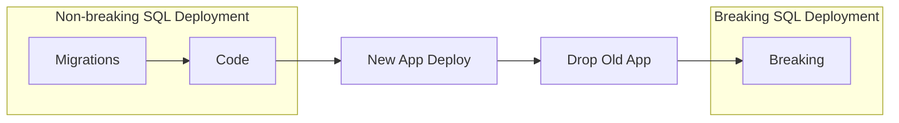

# Database as a Service

DbLive is built around one idea: **the database is a separate service in your system**. It has its own interface, its own deployment and its own tests, and applications are its clients. It does not have to be a separate process; it is a service because it has its **own contract and release cycle**, like a microservice.

The idea is not new. What DbLive adds is a library built around it: the deployment order, the separate breaking phase, the transaction model and the SQL tests exist so that the database can be released on its own, without stopping the applications that use it.

You do not have to adopt the whole model. DbLive also works as an ordinary migration tool; see [Ways to use DbLive](#ways-to-use-dblive).

## The problem DbLive solves

Most migration tools focus on **running SQL scripts in order**. DbLive focuses on **keeping production running** while the database moves ahead of the application.

| Traditional migration tools | DbLive |
|----------------------------|--------|
| Database schema and application change together | Database schema and interface evolve **before** app cutover |
| Destructive database changes block old apps immediately | Database breaking changes are **deferred** to a separate phase |
| Often assumes a maintenance window | Designed for **always-on** systems |

## The model

| Layer | Role | Changes via |
|-------|------|-------------|
| **Interface** | Procedures, functions, views: the **API** that applications call | Code deployment, versioned names |
| **Internal state** | Tables, indexes, triggers, data layout | Migrations |
| **Applications** | Clients of the interface | Their own deployments |

### What the interface is made of

- **Recommended: procedures and functions.** Behind a procedure almost anything can change: queries, joins, the tables themselves. A release stays under the control of the database developers.
- **Possible: views and direct access to tables.** DbLive does not prevent it. The price is that a table used by applications directly is part of the interface: when it has to change a lot, a seamless release is much harder.

**Procedures are not business logic.** DbLive does not recommend a "smart database" where domain rules, workflows or use cases live in stored procedures. Procedures are the interface: an abstraction over the data, like a service API or a repository.

### A procedure is a module with a history

One file holds one procedure, and the file is changed in place, like a method or a class in C#. The git history of the file is the history of the procedure; there is no separate file per version.

- **Only the implementation changes** (another query, other tables behind it): keep the name. `MyStoredProc_v1` is redeployed with the new body, and its callers do not notice.
- **The contract changes** (a new required parameter, other result columns, another meaning): rename the procedure in the same file to the next version.

```sql
-- Code/dbo/my-stored-proc.sql, earlier commit
create or alter proc dbo.MyStoredProc_v1
    @UserId int
as
    select UserId, Name from dbo.Users where UserId = @UserId
go
```

```sql
-- Code/dbo/my-stored-proc.sql, this commit: a new required parameter
create or alter proc dbo.MyStoredProc_v2
    @UserId int,
    @TenantId int
as
    select UserId, Name from dbo.Users where UserId = @UserId and TenantId = @TenantId
go
```

DbLive never drops code objects, so after the deployment the database has both versions: old applications call `_v1`, new ones call `_v2`. `_v1` is dropped in the [breaking phase](deployment/breaking-changes.md), once no application calls it:

```sql
drop proc if exists dbo.MyStoredProc_v1;
```

In DemoMSSQL, [`GetUser.sql`](https://github.com/zacoders/DbLive/blob/main/src/Demo/DemoMSSQL/Scripts/Code/dbo/stored-procedures/GetUser.sql) deploys `GetUser2`, and [`005.breaking.sql`](https://github.com/zacoders/DbLive/blob/main/src/Demo/DemoMSSQL/Scripts/Migrations/005.breaking.sql) drops the old `GetUser`.

## The release cycle



1. **Migrations are backward-compatible**: they expand the internal state (new tables, columns, indexes) and never remove or rename what a running application uses.
2. **Code deploy is backward-compatible**: new interface versions are deployed next to the old ones.
3. **The application deploy follows the database**: old and new applications run in parallel.
4. **Breaking changes are explicit and last**: only after the old applications are gone, they remove old interface versions, columns and temporary objects.

Steps 1 and 2 are one DbLive deployment (`DeployParameters.Default`), step 4 is another (`DeployParameters.Breaking`). This is the industry **expand / contract** pattern ([Evolutionary Database Design](https://martinfowler.com/articles/evodb.html)): expand first, move the callers, contract last.

How a migration expands the schema is up to the SQL developers. For example, to move data to a new table, a migration adds the table next to the old one, keeps them in sync with a temporary trigger and copies the existing data in the background, in small portions, without a long transaction that would lock the table. Applications that call the interface notice nothing; the breaking phase removes the old structure. See the [Table Split Example](examples/table-split.md).

### Transactions

DbLive does **not** wrap a deployment in one transaction by default, and that is part of the model:

- Each migration commits or rolls back **on its own**. Between migrations the database stays consistent and the applications keep working.
- A script can run **without a transaction** (`"TransactionWrapLevel": "None"` in its item settings file). This is for statements that cannot run inside a transaction (online index builds, `CREATE INDEX CONCURRENTLY`, some `ALTER DATABASE` options) and for long operations that would otherwise lock a busy table.
- One transaction for the whole deployment (`TransactionWrapLevel: Deployment`) exists for small databases and test environments, not for 24/7 systems.

Details: [Choosing a transaction level](project/configuration.md#choosing-a-transaction-level).

## Ways to use DbLive

| How you use it | What you use | What you get |
|----------------|--------------|--------------|
| **Classic** | Migrations and code | An ordinary migration tool: versioned scripts applied once, in order; procedures, functions and views from one file each |
| **Zero downtime** | Backward-compatible migrations, the breaking phase, scripts without a transaction where needed | Database releases without stopping the applications |
| **Database as a service** | All of the above, plus a versioned interface of procedures | The database is released independently; its internal state can change freely |

On any level you also get **SQL tests** (as xUnit tests against a temporary database, too), **rollback** with undo scripts, **checksums** of applied migrations and [ProjectId](features/project-id.md).

DbLive allows and encourages zero-downtime releases: its defaults (one transaction per migration, breaking scripts off unless requested) are chosen for them. A project can start classic and go further later; the next level adds files and conventions, not a different setup.

## What DbLive enforces vs team responsibility

### DbLive enforces

- Deploy order: migrations → code → (optional) breaking.
- Breaking only when `DeployBreaking = true`, and a breaking script never before its migration.
- Checksums of applied migrations, undo scripts stored in the database, optional [ProjectId](features/project-id.md) binding.

### The team must ensure

- Migration and code scripts are **actually** backward-compatible.
- A contract change gets a **new version name**; applications call the right version (`_v2`, not `_v1`).
- Procedures stay **thin**: data access and atomic database operations, not application business logic.
- Old application instances are drained before a breaking deploy.
- Breaking scripts drop every superseded object and column.

DbLive provides **rails**; compatibility discipline remains a team responsibility. The release checklist is in [Zero-Downtime Deployment](deployment/zero-downtime.md#pre-flight-checklist).

## How this differs from other tools

| Tool | Focus |
|------|--------|
| **Flyway / Liquibase** | Script versioning and conventions; no first-class breaking phase or interface lifecycle |
| **[grate](https://github.com/grate-devs/grate)** | RoundhousE-style runner; one-time vs any-time scripts, not compatibility phases |
| **DbLive** | Opinionated zero-downtime lifecycle for .NET + SQL; **database as a service** with a versioned procedure interface |

## When the full model fits

- Systems run **24/7** with no maintenance window.
- A database team owns the **interface and the internals**; application teams consume procedures as an API.
- Stored procedures and functions form a **data access boundary**, not a host for domain logic.
- Teams practice expand/contract and want those rules **encoded in the tool**.

When downtime is acceptable, or an ORM owns the whole data model with no procedure boundary, the classic way is enough. You still get versioned migrations, code objects, SQL tests and rollback.

## Next steps

- [Getting Started](gettingstarted.md): set up a project and run the first deployment
- [Zero-Downtime Deployment](deployment/zero-downtime.md): the release runbook
- [Table Split Example](examples/table-split.md): expand/contract in practice
- [Breaking Changes](deployment/breaking-changes.md): the contract phase
- [DemoMSSQL](https://github.com/zacoders/DbLive/tree/main/src/Demo/DemoMSSQL): migrations, code, breaking, and tests
