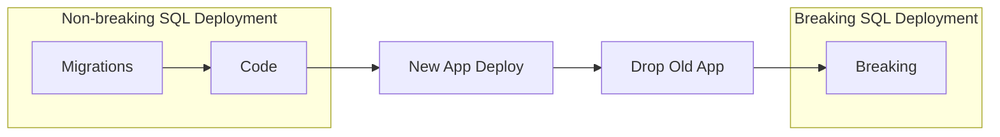

# Breaking Changes

A **breaking change** removes something a running application may still use: a column, a table, a procedure version, a temporary sync trigger. DbLive keeps those changes out of the normal deployment and runs them in a separate **breaking** deployment, after the old application version has been shut down. This is the *contract* half of the expand/contract pattern described in [Philosophy](../philosophy.md).

## Writing a breaking script

A breaking script belongs to a migration version and is named `<version>.breaking.sql` (or `<version>.b.sql`):

```
Migrations/
  20260812090000.split-phones.sql       expand: new table, sync trigger
  20260812090000.breaking.sql           contract: drop trigger and old column
  20260812090000.undo.sql               revert, whether or not breaking ran
```

```sql
-- 20260812090000.breaking.sql
drop trigger if exists dbo.TMP_DataMigration_Person_To_PersonPhones;
go

alter table dbo.Person drop column if exists PhoneNumber;
go

drop proc if exists dbo.GetPerson_v1;
go
```

Make breaking scripts tolerant (`if exists`), and make the version's undo script handle both states: breaking applied and not applied.

## When breaking scripts run

- Only when `DeployBreaking = true`, for example with `DeployParameters.Breaking`.
- After migrations and code, in the same deployment.
- For every version whose **migration is already applied** and whose breaking script is not. A breaking script never runs before its migration.
- In version order, **each in its own transaction** with the default `TransactionWrapLevel: Migration`, so the breaking scripts that ran before a failed one stay applied. `<version>.breaking.settings.json` sets the [transaction level, isolation level and timeout](../project/configuration.md#item-settings) of one breaking script; the migration's settings file does not apply to it.
- Once applied, a breaking script is protected by a [checksum](migrations.md#checksums) like a migration. Before it is applied you can still edit it.

```csharp
// The old application is gone: contract the schema.
await deployer.DeployAsync(DeployParameters.Breaking);
```

`DeployParameters.Breaking` deploys no migrations, no code and runs no tests. `DeployParameters.BreakingAndTests` also runs the SQL tests afterwards. BeforeDeploy and AfterDeploy scripts run in both cases.

## Release flow



1. Deploy with `DeployParameters.Default` (migrations and code).
2. Deploy the new application; old and new instances run side by side.
3. Drain and remove the old application.
4. Deploy with `DeployParameters.Breaking`.

The breaking deployment is safe to repeat: when nothing is pending, it logs `No breaking changes to apply.`

## In tests

Test databases usually get everything at once. The `[SqlFact]` fixture deploys migrations, code **and** breaking scripts before the SQL tests run, and the `[SqlDeployFact]` deployment test runs every scenario with and without breaking changes. See [Unit Testing](../unit-testing/index.md).

## What DbLive cannot check

DbLive guarantees the order (breaking runs last and only on request), not the content. Your team still has to make sure that:

- migrations and code are really backward compatible;
- no old application instance is running when the breaking deployment starts;
- breaking scripts remove every superseded object, column and temporary trigger.

The step-by-step runbook with a checklist is in [Zero-Downtime Deployment](zero-downtime.md).
