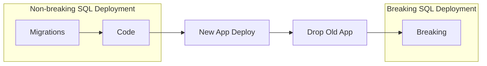
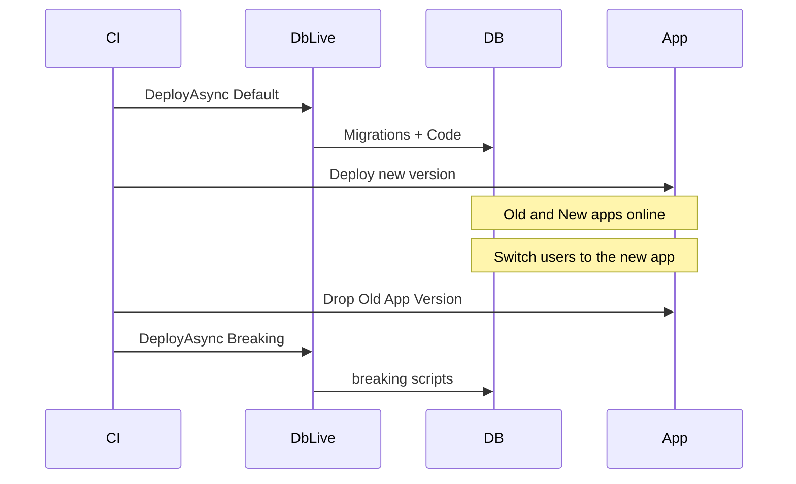

# Zero-Downtime Deployment (24/7)

This is the practical runbook for shipping database changes to an **always-on** system with DbLive - no maintenance window, no dropped requests. The application keeps serving traffic while the database moves ahead of it.

It all works because of **one rule**: every migration and every code deploy is **backward-compatible**, and anything destructive is deferred to an explicit **breaking** phase that runs only after the old application is gone.

For the reasoning behind this model ([Database-as-a-service](../database-as-service.md), the versioned procedure interface, expand/contract), see [Philosophy](../philosophy.md). This page focuses on *how* to do it.

## The golden rule

> Never break a running caller. Add the new; remove the old later.

- The database is a **service** with a **versioned SQL interface** (procedures, functions, views). Applications call named, versioned objects - not internal tables.
- **Migrations only expand** internal state (add tables, columns, indexes, sync triggers). They never remove or rename what a running app still depends on.
- **Breaking contracts** the schema (drop legacy procedures, columns, triggers) and runs **last**, once no old app instances remain.

## Deploy order DbLive enforces

Every deploy runs in this fixed order: **migrations, then code, then (optionally) breaking**.



You run the non-breaking part (migrations + code) **before** the application rollout, and the breaking part **after** the old application is drained. See [Deployment flow](../../README.md#deployment-flow) for the full step list.

## The recipe

Follow these six steps for any change you want to ship without downtime.

### Step 1 - Write a backward-compatible migration

Migrations may only **expand**. Add tables, columns (nullable or with a default), and indexes. When reshaping storage, add the new structure alongside the old and keep them in sync with a temporary trigger. Do **not** drop or rename anything a running application still reads.

```sql
-- Expand: add the new table, keep the legacy column in place for now
create table dbo.PersonPhones
(
    PersonPhoneId int not null identity(1,1),
    PersonId int not null,
    PhoneNumber nvarchar(30) not null,
    constraint PK_PersonPhones primary key (PersonPhoneId)
);
go
-- Temporary sync so old and new storage stay consistent during the transition
create trigger dbo.TR_Person_SyncPhone on dbo.Person
after insert, update
as
begin
    -- keep dbo.PersonPhones in sync with dbo.Person.PhoneNumber
end
go
```

Building an index on a large, live table? Create it online so writers are not blocked - see the transactions note below.

### Step 2 - Add a new procedure version, do not mutate the old one

The interface is versioned. When the contract changes, **add a new version** (`GetUsers_v2`) instead of editing the version old apps still call (`GetUsers_v1`). Keep one file per logical object; git history is your change log.

```sql
-- Earlier commit: GetUsers_v1 (still called by old apps)
create or alter proc dbo.GetUsers_v1
as
    select Id, UserName from dbo.Users where Deleted = 0
go
```

```sql
-- This commit: same file, new version for the new app
create or alter proc dbo.GetUsers_v2
as
    select Id, UserName from dbo.Users where Deleted = 0 and Active = 1
go
```

DbLive re-deploys code files but does **not** drop objects that are no longer mentioned. `GetUsers_v1` stays in the database until the breaking phase, so old callers keep working.

### Step 3 - Deploy the database (non-breaking)

Deploy migrations + code with the `Default` preset. Breaking is off, so nothing destructive runs.

```csharp
var deployer = new DbLiveBuilder()
    .LogToConsole()
    .SqlServer()
    .SetDbConnection(dbCnnString)
    .SetProject(Assembly.GetExecutingAssembly())
    .CreateDeployer();

// Migrations + Code, no breaking. Run this BEFORE the app rollout.
await deployer.DeployAsync(DeployParameters.Default);
```

After this step the database serves **both** `GetUsers_v1` and `GetUsers_v2`. The old application is still fully functional.

### Step 4 - Roll out the new application

Deploy the new application version, which calls `GetUsers_v2`. Use a rolling or blue-green rollout so old and new instances run **in parallel** - both are valid against the current database.

### Step 5 - Drain the old application

Shift all traffic to the new version and wait for old instances to finish in-flight work, then remove them. Do not proceed until **no** instance calls the legacy interface (`_v1`) anymore.

### Step 6 - Run the breaking phase

Only now, with no old callers left, run the `Breaking` preset to contract the schema: drop superseded procedures, remove legacy columns, and delete temporary sync triggers.

```csharp
// Old app is gone. Safe to drop legacy objects and columns.
await deployer.DeployAsync(DeployParameters.Breaking);
```

```sql
-- Example breaking script content
drop proc if exists dbo.GetUsers_v1
```

## Deploy presets

DbLive ships presets that map directly onto this workflow (see [`DeployParameters`](../../src/DbLive/DeployParameters.cs)):

| Preset | Migrations | Code | Breaking | Tests |
|--------|------------|------|----------|-------|
| `DeployParameters.Default` | Yes | Yes | No | Yes |
| `DeployParameters.Breaking` | No | No | Yes | No |
| `DeployParameters.BreakingAndTests` | No | No | Yes | Yes |

Run **Default** before the application deploy (Step 3). Run **Breaking** only after the old application is gone (Step 6). Tests are not recommended against production databases.

## A note on transactions

DbLive does **not** wrap the whole deployment in a single transaction, and that is intentional for 24/7 systems:

- The default `TransactionWrapLevel` is **`Migration`** - each migration commits or rolls back on its own (see [Project Configuration](../project/configuration.md)).
- Between migrations the system stays **operational**. That is a feature, not a missing safeguard.
- A migration can override the level when needed - for example, set `"TransactionWrapLevel": "none"` for online index creation so building an index does not hold a long transaction against a live table.

## Worked example: splitting a column into a table

The move phone data out of `Person` into a dedicated `PersonPhones` table is a complete zero-downtime change:

| Step | Artifact | What happens |
|------|----------|--------------|
| Migration | [007.migration.sql](../../src/Demo/DemoMSSQL/Scripts/Migrations/007.migration.sql) | New `PersonPhones` table and sync trigger; legacy `PhoneNumber` column stays |
| Deploy (Default) | your pipeline | Database now serves both old and new procedure versions |
| App deploy | your pipeline | New app version calls the updated procedures |
| Breaking | [007.breaking.sql](../../src/Demo/DemoMSSQL/Scripts/Migrations/007.breaking.sql) | Drop the sync trigger and the legacy `PhoneNumber` column |

For a fuller narrative of the same transition, see [Table Split Example](../examples/table-split.md).

## Pre-flight checklist

Before you deploy, confirm each of these - DbLive provides the rails, but backward-compatibility discipline is a team responsibility:

- [ ] The migration only **expands** (no dropped or renamed columns/tables that a running app uses).
- [ ] Reshaped storage has a **sync trigger** keeping old and new in step during the transition.
- [ ] Interface changes add a **new procedure version** rather than mutating the old one.
- [ ] Procedures stay **thin** - data access and atomic DB operations, not application business logic.
- [ ] The new application references the **correct version** (`_v2`, not `_v1`) and never queries internal tables directly.
- [ ] Old application instances are **fully drained** before the breaking deploy.
- [ ] The breaking script drops **every** superseded object, column, and temporary trigger.

## CI/CD mapping

A release pipeline separates the safe deploy from the breaking deploy:



Run **Default** as part of (or just before) the application release. Gate **Breaking** behind a separate step that runs only once the old application has been decommissioned.

## Next steps

- [Philosophy](../philosophy.md) - the why behind zero-downtime and database-as-a-service
- [Getting Started](../gettingstarted.md) - set up a project and run your first deploy
- [Table Split Example](../examples/table-split.md) - expand/contract in practice
- [Project Configuration](../project/configuration.md) - `TransactionWrapLevel` and other settings
- [DemoMSSQL](../../src/Demo/DemoMSSQL/) - migrations, code, breaking, and tests
