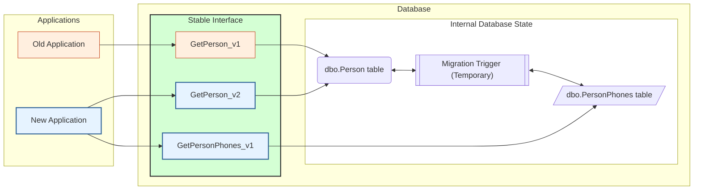

# Table Split Example

**Scenario:** The `dbo.Person` table currently has a `PhoneNumber` column. Business requirements 
change to support multiple phone numbers per person, meaning the data must be moved to a new 
`dbo.PersonPhones` table.

Instead of a destructive migration that immediately breaks existing applications, DbLive recommends 
this transition seamlessly:

1. **Internal State:** A temporary trigger is introduced to synchronize data between the 
   legacy `dbo.Person.PhoneNumber` column and the new `dbo.PersonPhones` table in real-time.
2. **Old Applications:** Continue using `GetPerson_v1`. The database still fulfills this 
   contract, allowing legacy apps to function without interruption.
3. **New Applications:** Upgrade to `GetPerson_v2` for core person data and use a new 
   `GetPersonPhones_v1` procedure to retrieve the list of multiple phone numbers.
4. **Breaking Phase (Cleanup):** Once all old applications are decommissioned, you can 
   safely run breaking migrations to clean up the legacy state:
   - The legacy `GetPerson_v1` procedure is dropped.
   - The temporary migration trigger is removed, as it is no longer needed.
   - The redundant `PhoneNumber` column is dropped from the `dbo.Person` table.

## Moving the existing data

The trigger keeps new writes in sync; the rows that already exist still have to be copied. How to do it is up to the SQL developers; this is one example. DemoMSSQL copies them with one `update` that fires the trigger, which is fine for a small table. On a large, busy table a single statement in one transaction would lock the table for the whole copy. Instead, copy the data in the background in small batches, in a migration that runs without a transaction (`"TransactionWrapLevel": "None"` in its [item settings file](../project/configuration.md#item-settings)), so each batch commits on its own. Such a script must be re-runnable: if it stops halfway, the next deployment runs it again from the start.

## In DemoMSSQL

The demo implements the storage side of this example (no `GetPerson` procedures):

| Step | Artifact | What happens |
|------|----------|--------------|
| Migration | [007.migration.sql](https://github.com/zacoders/DbLive/blob/main/src/Demo/DemoMSSQL/Scripts/Migrations/007.migration.sql) | New `PersonPhones` table and sync trigger; existing rows are copied; the legacy `PhoneNumber` column stays |
| Deploy (`Default`) | your pipeline | Old and new storage both work |
| App deploy | your pipeline | The new application version uses the new storage through the updated procedures |
| Breaking | [007.breaking.sql](https://github.com/zacoders/DbLive/blob/main/src/Demo/DemoMSSQL/Scripts/Migrations/007.breaking.sql) | Drop the sync trigger and the legacy `PhoneNumber` column |
| Undo | [007.undo.sql](https://github.com/zacoders/DbLive/blob/main/src/Demo/DemoMSSQL/Scripts/Migrations/007.undo.sql) | Revert, whether or not the breaking script ran |

See [Zero-Downtime Deployment](../deployment/zero-downtime.md) for the release steps.
