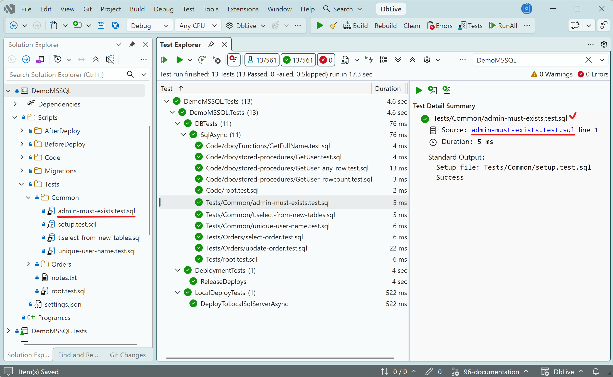

# Unit Testing

DbLive tests are plain `.sql` files with Arrange, Act and Assert sections. Every test runs inside a transaction that is **always rolled back**, so tests need no cleanup and can run again and again. Tests run in two places:

- at the end of a deployment, when `RunTests` is true;
- as normal xUnit tests in Visual Studio Test Explorer and in `dotnet test`, one test case per file (package `DbLive.xunit`).

With xUnit you need no shared test database. The test fixture deploys your scripts into a new database, in Docker (Testcontainers) or on a local server, runs the tests against it and drops it at the end. SQL tests then work like ordinary C# unit tests: every developer and every CI run gets the same database, built from the same scripts.

Tutorial: [Add a Stored Procedure and a Unit Test](stored-proc-and-unit-test.md).

## Where tests live

| Location | Which files are tests |
|----------|-----------------------|
| `Tests` and its subfolders | every `.sql` file except `setup.test.sql` |
| `Code` and its subfolders | files matching `TestFilePatterns`: `test.*.sql`, `t.*.sql`, `*.test.sql`, `*.t.sql` by default, except `setup.test.sql` |

Keep a test next to the object it tests (`Code/dbo/GetUser.sql` and `Code/dbo/GetUser.test.sql`). Use `Tests` for checks that span several objects or verify data rules.

## Anatomy of a test

```sql
-- Arrange
set identity_insert dbo.Users on;
insert into dbo.Users (UserId, Name) values (10, 'TestUser10');

-- Act
exec dbo.GetUser_v2 @UserId = 10;

-- Assert
select assert = 'rows';
select 10 as UserId, 'TestUser10' as Name;
```

The **assert result set** is a result set whose first column is named `assert` (in any case). Its value chooses the assertion. Result sets returned **before** it are the actual results; result sets **after** it are the expected results. Statements that return no result set (`insert`, `set`, `declare`) are ignored.

A misspelled column (`select asstert = 'rows'`) or a missing alias (`select 'rows'`) does not silently turn the assertion off: the test fails with a message that names the column.

!!! warning "No `GO` in SQL Server test files"
    A test file is executed as a single batch, so `GO` is a syntax error there. `setup.test.sql`, migrations and code files may use `GO`.

## Assertions

| Assert | Passes when |
|--------|-------------|
| `rows` | There are as many actual result sets as expected ones, and each expected result set matches the actual result set at the same position: same column names in the same order, same number of rows, same values row by row. |
| `rows-with-schema` | Like `rows`, and the SQL column types match as well (for example `nvarchar(255)` vs `nvarchar(100)` fails). |
| `has-rows` | The first actual result set has at least one row. |
| `row-count=N` | There is exactly one actual result set, with exactly N rows. |
| `empty` | Shortcut for `row-count=0`. |
| `single-row` | Shortcut for `row-count=1`. |
| _(none)_ | The test passes if the script runs without an error. |

Only one assert result set is allowed per test. Assert values are case-insensitive.

### Custom checks

Without an assert result set, raise an error to fail the test:

```sql
-- SQL Server
declare @cnt int = (select count(*) from dbo.Users where Name = 'Admin');
if @cnt != 1 throw 50000, 'Expected one admin user.', 0;
```

```sql
-- PostgreSQL
do $$
begin
    if (select count(*) from users where name = 'Admin') != 1 then
        raise exception 'Expected one admin user.';
    end if;
end $$;
```

### How values are compared

`rows` compares each value by its JSON representation:

- `int` 10 and `bigint` 10 are equal.
- `decimal` values must have the same scale: `150.00` is not `150` and not `150.0`. Cast the expected value, for example `cast(150 as decimal(10,2))`.
- Strings are compared exactly, including case and trailing spaces.
- A date or time value is never equal to a string. Cast the expected value: `cast('2026-01-01' as date)`.
- `NULL` equals `NULL`.
- Row order matters; use `order by` in the act.
- Column names must match exactly. SQL Server gives an unnamed expression an empty name, so `select dbo.GetFullName('a', 'b')` can be compared with `select cast('a b' as nvarchar(255))`. PostgreSQL names such columns (`?column?` or the function name), so give both sides an alias.

!!! note "`rows` compares all actual output"
    `rows` fails on extra or missing result sets and rows, for example `Expected 1 row(s), but 3 received.` Every result set returned before the assert counts as actual, including output from the Arrange part (`update ... output`, a debugging `select`). Remove such output, or move the setup into `setup.test.sql`.

`row-count` counts rows of the actual result set: `select count(*) from dbo.Orders` returns **one** row. To check that there are three orders, select the orders themselves:

```sql
select OrderId from dbo.Orders;
select assert = 'row-count=3';
```

## Shared setup with `setup.test.sql`

A `setup.test.sql` file runs before **each** test in the same folder, inside the test's transaction. It works in `Tests` and in `Code`:

```text
Tests/
  Orders/
    setup.test.sql           inserts three orders
    select-orders.test.sql
    update-order.test.sql
Code/
  dbo/
    GetUser.sql
    GetUser.test.sql
    setup.test.sql           inserts test users
```

- It applies to tests in its own folder only, not to subfolders.
- It runs on a separate connection within the same transaction. Rows it inserts are visible to the test; session state is not (temporary tables, variables, `SET` options).
- It is never a test itself and never deployed as code, whatever `TestFilePatterns` contains.

## Isolation and parallelism

- Each test runs in its own transaction with `TestsTransactionIsolationLevel` (default `Serializable`) and a timeout of `UnitTestItemTimeout` (default 1 minute). The transaction is rolled back after the assertion, whatever the result.
- During a deployment, tests run in parallel (`NumberOfThreadsForTestsRun`, default 10). Tests that write to the same tables under `Serializable` can deadlock; lower the thread count to 1 or use `ReadCommitted` if that happens.
- Results are saved in `dblive.unit_test_run`. If any test fails, `DeployAsync` throws `UnitTestsFailedException` after all tests have run. The deployment itself has already been committed at that point, so catching this type tells "deployed, tests failed" apart from "deployment failed". The exception has `FailedCount`, `TotalCount` and `FailedTests` (relative paths of the failed test files).

## Running tests in Visual Studio and CI (xUnit)

`DbLive.xunit` (xUnit v2) turns every SQL test file into an xUnit test case. Create a test project that references your SQL project and these packages: `Microsoft.NET.Test.Sdk`, `xunit`, `xunit.runner.visualstudio`, `DbLive.xunit`, the provider package, and `Testcontainers.MsSql` (or `Testcontainers.PostgreSql`) if you test against Docker.

### 1. A fixture builder

The builder tells DbLive which database to use. This one starts SQL Server in Docker once per test run and gives every fixture its own random database:

```csharp
using DbLive;
using DbLive.MSSQL;
using DbLive.xunit;
using DotNet.Testcontainers.Containers;
using System.Reflection;
using Testcontainers.MsSql;

public class DockerMsSqlFixtureBuilder : IDbLiveFixtureBuilder
{
    private static readonly MsSqlContainer _container =
        new MsSqlBuilder("mcr.microsoft.com/mssql/server:2025-latest").Build();

    public async Task<DbLiveBuilder> GetBuilderAsync()
    {
        if (_container.State != TestcontainersStates.Running)
            await _container.StartAsync().ConfigureAwait(false);

        string connectionString = _container.GetConnectionString().SetRandomMsSqlDatabaseName();

        return new DbLiveBuilder()
            .SqlServer()
            .SetDbConnection(connectionString)
            .SetProject(GetProjectAssembly());
    }

    public Assembly GetProjectAssembly() => Assembly.Load("MyDb");
}
```

Without Docker, point the builder at a local server instead:

```csharp
string connectionString = "Server=localhost;Database=master;Trusted_Connection=True;TrustServerCertificate=True;"
    .SetRandomMsSqlDatabaseName();
```

For PostgreSQL use `PostgreSqlContainer` / `new PostgreSqlBuilder("postgres:latest").Build()`, `.PostgreSQL()` and `.SetRandomPostgreSqlDatabaseName()`.

### 2. SQL tests: `[SqlFact]`

```csharp
using DbLive.Deployers.Testing;
using DbLive.xunit.SqlTest;
using Xunit;
using Xunit.Abstractions;

public class MyDbTestFixture()
    : DbLiveTestFixture(fixtureBuilder: new DockerMsSqlFixtureBuilder(), dropDatabaseOnComplete: true)
{
}

public class SqlTests(ITestOutputHelper output, MyDbTestFixture fixture)
    : IClassFixture<MyDbTestFixture>
{
    [SqlFact(TestFixture = typeof(MyDbTestFixture))]
    public async Task Sql(string testFileRelativePath)
    {
        TestRunResult result = await fixture.Tester!.RunTestAsync(output.WriteLine, testFileRelativePath);
        Assert.True(result.IsSuccess, result.ErrorMessage);
    }
}
```

- The fixture class must derive from `DbLiveTestFixture` and have a public parameterless constructor.
- The fixture deploys the project once per test class (migrations, code and breaking changes, no tests) into a fresh database and drops it at the end if `dropDatabaseOnComplete` is true.
- Each SQL file appears in Test Explorer under its relative path; "Go to source" opens the `.sql` file (it needs the `ProjectDir` metadata from the [`.csproj` block](../project/index.md#the-csproj-block)).
- The tests read the scripts embedded in the SQL project's dll. Test Explorer and `dotnet test` build before running, so changed scripts are picked up; new test files appear after a build.



### Deployment tests

`[SqlDeployFact]` checks that the whole project deploys to an empty database, and that undo scripts restore the schema:

```csharp
using DbLive.Common;
using DbLive.xunit.Deploy;
using Xunit;
using Xunit.Abstractions;

public class DeploymentTests(ITestOutputHelper output) : IAsyncLifetime
{
    private readonly DeployFixture _fixture = new(
        builderProvider: new DockerMsSqlFixtureBuilder(),
        dropDatabaseOnComplete: true);

    public Task InitializeAsync() => _fixture.InitializeAsync();
    public Task DisposeAsync() => _fixture.DisposeAsync();

    [SqlDeployFact]
    public async Task Deploy(bool deployBreaking, UndoTestMode undoTestMode)
        => await _fixture.DeployAsync(output, deployBreaking, undoTestMode);
}
```

It produces six test cases: with and without breaking changes, each in three undo modes:

| Undo mode | Sequence for every version that has an undo script |
|-----------|---------------------------------------------------|
| `None` | migration |
| `MigrationUndoMigration` | migration, undo, migration |
| `MigrationBreakingUndoMigration` | migration, breaking, breaking, undo, migration |

Each case deploys to a fresh database and then runs all SQL tests. Together they prove that migrations apply cleanly, that undo scripts revert them (with and without the breaking part), and that a version can be re-applied after an undo.

In the cases with breaking changes, a second, separate deployment with `DeployParameters.Breaking` follows, as in production. It proves that the [breaking scripts of the Code folder](../deployment/breaking-changes.md#dropping-an-old-procedure-version) can run again (they run on every breaking deployment), that the breaking deployment is allowed after a normal one, and that BeforeDeploy and AfterDeploy scripts can run again too. The breaking script of a migration runs twice in `MigrationBreakingUndoMigration`, because a failed breaking script with `TransactionWrapLevel: None` runs again on the next deployment. The database is new, so an old object version such as `_v1` never existed in it: these tests do not prove that dropping an `_v1` that really exists works.

#### Schema checks

A script that runs without an error can still be wrong: an undo that forgets to add back the column the breaking script dropped runs fine, and so does the migration after it. So the deployment test also reads the schema of the database from its catalog and compares it at three points:

| Check | Must be equal |
|-------|---------------|
| Undo (both undo modes) | the schema before the migration and the schema after its undo |
| Second breaking run (`MigrationBreakingUndoMigration`) | the schema after the first and after the second run of a migration breaking script |
| Second breaking deployment (cases with breaking) | the schema before and after the second deployment with `DeployParameters.Breaking` |

The second check matters for rollbacks: in production a breaking script runs once and the rollback runs the undo after that one run. If the second run of the script changes more than the first one, the test would check the undo against a state production never has, so it fails instead.

The comparison covers tables, columns (type, nullability, default, identity, computed expression, collation), keys, foreign keys, check constraints, indexes, views, functions, procedures, triggers, user types and sequences. It ignores DbLive's own `dblive` schema, data, column order (an undo can only add a column back at the end of the table), the names SQL Server generates for unnamed constraints, and current identity and sequence values. The full list is in the [agent reference](https://zacoders.github.io/DbLive/llms-full.txt), Section 13.3.

A difference fails the test case with `SchemaChangedException`, which names the check and the script and lists what differs:

```
Undo test: Migrations/002.undo.sql does not restore the schema. The schema after the undo differs from the schema before Migrations/002.migration.sql:
  missing check constraint dbo.Person.CK_Person_Name: check ([Name]<>'')
  missing index dbo.Person.IX_Person_Name: nonclustered (Name asc)
  missing column dbo.Person.Phone: varchar(20) collate SQL_Latin1_General_CP1_CI_AS null
```

`missing` objects were in the earlier schema only, `extra` objects are in the later one only, and `changed` objects show the old and the new definition. Data is not compared. The checks need SQL Server 2017 or later (every SQL Server Docker image) or PostgreSQL 12 or later.
