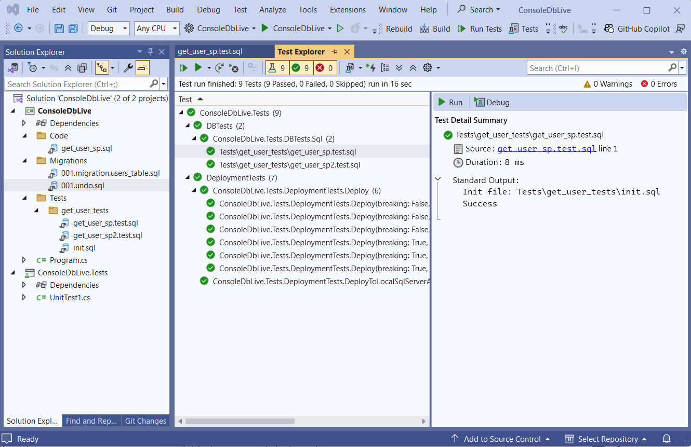

# Unit Testing

DbLive tests are plain `.sql` files with Arrange, Act and Assert sections. Every test runs inside a transaction that is **always rolled back**, so tests need no cleanup and can run again and again. Tests run in two places:

- at the end of a deployment, when `RunTests` is true;
- as normal xUnit tests in Visual Studio Test Explorer and in `dotnet test`, one test case per file (package `DbLive.xunit`).

Tutorial: [Add a Stored Procedure and a Unit Test](stored-proc-and-unit-test.md).

## Where tests live

| Location | Which files are tests |
|----------|-----------------------|
| `Tests` and its subfolders | every `.sql` file except `init.sql` |
| `Code` and its subfolders | files matching `TestFilePatterns`: `test.*.sql`, `t.*.sql`, `*.test.sql`, `*.t.sql` by default |

Keep a test next to the object it tests (`Code/dbo/GetUser.sql` and `Code/dbo/GetUser.test.sql`). Use `Tests` for checks that span several objects or verify data rules.

## Anatomy of a test

```sql
-- Arrange
set identity_insert dbo.Users on;
insert into dbo.Users (UserId, Name) values (10, 'TestUser10');

-- Act
exec dbo.GetUser_v2 @UserId = 10;

-- Assert
select assert = 'rows';
select 10 as UserId, 'TestUser10' as Name;
```

The **assert result set** is a result set whose first column is named `assert` (in any case). Its value chooses the assertion. Result sets returned **before** it are the actual results; result sets **after** it are the expected results. Statements that return no result set (`insert`, `set`, `declare`) are ignored.

A misspelled column (`select asstert = 'rows'`) or a missing alias (`select 'rows'`) does not silently turn the assertion off: the test fails with a message that names the column.

!!! warning "No `GO` in SQL Server test files"
    A test file is executed as a single batch, so `GO` is a syntax error there. `init.sql`, migrations and code files may use `GO`.

## Assertions

| Assert | Passes when |
|--------|-------------|
| `rows` | There are as many actual result sets as expected ones, and each expected result set matches the actual result set at the same position: same column names in the same order, same number of rows, same values row by row. |
| `rows-with-schema` | Like `rows`, and the SQL column types match as well (for example `nvarchar(255)` vs `nvarchar(100)` fails). |
| `has-rows` | The first actual result set has at least one row. |
| `row-count=N` | There is exactly one actual result set, with exactly N rows. |
| `empty` | Shortcut for `row-count=0`. |
| `single-row` | Shortcut for `row-count=1`. |
| _(none)_ | The test passes if the script runs without an error. |

Only one assert result set is allowed per test. Assert values are case-insensitive.

### Custom checks

Without an assert result set, raise an error to fail the test:

```sql
-- SQL Server
declare @cnt int = (select count(*) from dbo.Users where Name = 'Admin');
if @cnt != 1 throw 50000, 'Expected one admin user.', 0;
```

```sql
-- PostgreSQL
do $$
begin
    if (select count(*) from users where name = 'Admin') != 1 then
        raise exception 'Expected one admin user.';
    end if;
end $$;
```

### How values are compared

`rows` compares each value by its JSON representation:

- `int` 10 and `bigint` 10 are equal.
- `decimal` values must have the same scale: `150.00` is not `150` and not `150.0`. Cast the expected value, for example `cast(150 as decimal(10,2))`.
- Strings are compared exactly, including case and trailing spaces.
- A date or time value is never equal to a string. Cast the expected value: `cast('2026-01-01' as date)`.
- `NULL` equals `NULL`.
- Row order matters; use `order by` in the act.
- Column names must match exactly. SQL Server gives an unnamed expression an empty name, so `select dbo.GetFullName('a', 'b')` can be compared with `select cast('a b' as nvarchar(255))`. PostgreSQL names such columns (`?column?` or the function name), so give both sides an alias.

!!! note "`rows` compares all actual output"
    `rows` fails on extra or missing result sets and rows, for example `Expected 1 row(s), but 3 received.` Every result set returned before the assert counts as actual, including output from the Arrange part (`update ... output`, a debugging `select`). Remove such output, or move the setup into `init.sql`.

`row-count` counts rows of the actual result set: `select count(*) from dbo.Orders` returns **one** row. To check that there are three orders, select the orders themselves:

```sql
select OrderId from dbo.Orders;
select assert = 'row-count=3';
```

## Shared setup with `init.sql`

An `init.sql` file runs before **each** test in the same folder, inside the test's transaction:

```text
Tests/
  Orders/
    init.sql                 inserts three orders
    select-orders.test.sql
    update-order.test.sql
```

- It applies to tests in its own folder only, not to subfolders.
- It runs on a separate connection within the same transaction. Rows it inserts are visible to the test; session state is not (temporary tables, variables, `SET` options).
- Put `init.sql` in `Tests` folders only. Inside `Code` it would also be deployed as a code object.

## Isolation and parallelism

- Each test runs in its own transaction with `TestsTransactionIsolationLevel` (default `Serializable`) and a timeout of `UnitTestItemTimeout` (default 1 minute). The transaction is rolled back after the assertion, whatever the result.
- During a deployment, tests run in parallel (`NumberOfThreadsForTestsRun`, default 10). Tests that write to the same tables under `Serializable` can deadlock; lower the thread count to 1 or use `ReadCommitted` if that happens.
- Results are saved in `dblive.unit_test_run`. If any test fails, `DeployAsync` throws after all tests have run. The deployment itself has already been committed at that point.

## Running tests in Visual Studio and CI (xUnit)

`DbLive.xunit` (xUnit v2) turns every SQL test file into an xUnit test case. Create a test project that references your SQL project and these packages: `Microsoft.NET.Test.Sdk`, `xunit`, `xunit.runner.visualstudio`, `DbLive.xunit`, the provider package, and `Testcontainers.MsSql` (or `Testcontainers.PostgreSql`) if you test against Docker.

### 1. A fixture builder

The builder tells DbLive which database to use. This one starts SQL Server in Docker once per test run and gives every fixture its own random database:

```csharp
using DbLive;
using DbLive.MSSQL;
using DbLive.xunit;
using DotNet.Testcontainers.Containers;
using System.Reflection;
using Testcontainers.MsSql;

public class DockerMsSqlFixtureBuilder : IDbLiveFixtureBuilder
{
    private static readonly MsSqlContainer _container =
        new MsSqlBuilder("mcr.microsoft.com/mssql/server:2025-latest").Build();

    public async Task<DbLiveBuilder> GetBuilderAsync()
    {
        if (_container.State != TestcontainersStates.Running)
            await _container.StartAsync().ConfigureAwait(false);

        string connectionString = _container.GetConnectionString().SetRandomMsSqlDatabaseName();

        return new DbLiveBuilder()
            .SqlServer()
            .SetDbConnection(connectionString)
            .SetProject(GetProjectAssembly(), useVsProjectPath: true);
    }

    public Assembly GetProjectAssembly() => Assembly.Load("MyDb");
}
```

Without Docker, point the builder at a local server instead:

```csharp
string connectionString = "Server=localhost;Database=master;Trusted_Connection=True;TrustServerCertificate=True;"
    .SetRandomMsSqlDatabaseName();
```

For PostgreSQL use `PostgreSqlContainer` / `new PostgreSqlBuilder("postgres:latest").Build()`, `.PostgreSQL()` and `.SetRandomPostgreSqlDatabaseName()`.

### 2. SQL tests: `[SqlFact]`

```csharp
using DbLive.Deployers.Testing;
using DbLive.xunit.SqlTest;
using Xunit;
using Xunit.Abstractions;

public class MyDbTestFixture()
    : DbLiveTestFixture(fixtureBuilder: new DockerMsSqlFixtureBuilder(), dropDatabaseOnComplete: true)
{
}

public class SqlTests(ITestOutputHelper output, MyDbTestFixture fixture)
    : IClassFixture<MyDbTestFixture>
{
    [SqlFact(TestFixture = typeof(MyDbTestFixture))]
    public async Task Sql(string testFileRelativePath)
    {
        TestRunResult result = await fixture.Tester!.RunTestAsync(output.WriteLine, testFileRelativePath);
        Assert.True(result.IsSuccess, result.ErrorMessage);
    }
}
```

- The fixture class must derive from `DbLiveTestFixture` and have a public parameterless constructor.
- The fixture deploys the project once per test class (migrations, code and breaking changes, no tests) into a fresh database and drops it at the end if `dropDatabaseOnComplete` is true.
- Each SQL file appears in Test Explorer under its relative path; "Go to source" opens the `.sql` file. New test files appear after a build.



### Deployment tests

`[SqlDeployFact]` checks that the whole project deploys to an empty database, and that undo scripts work:

```csharp
using DbLive.Common;
using DbLive.xunit.Deploy;
using Xunit;
using Xunit.Abstractions;

public class DeploymentTests(ITestOutputHelper output) : IAsyncLifetime
{
    private readonly DeployFixture _fixture = new(
        builderProvider: new DockerMsSqlFixtureBuilder(),
        dropDatabaseOnComplete: true);

    public Task InitializeAsync() => _fixture.InitializeAsync();
    public Task DisposeAsync() => _fixture.DisposeAsync();

    [SqlDeployFact]
    public async Task Deploy(bool deployBreaking, UndoTestMode undoTestMode)
        => await _fixture.DeployAsync(output, deployBreaking, undoTestMode);
}
```

It produces six test cases: with and without breaking changes, each in three undo modes:

| Undo mode | Sequence for every version that has an undo script |
|-----------|---------------------------------------------------|
| `None` | migration |
| `MigrationUndoMigration` | migration, undo, migration |
| `MigrationBreakingUndoMigration` | migration, breaking, undo, migration |

Each case deploys to a fresh database and then runs all SQL tests. Together they prove that migrations apply cleanly, that undo scripts revert them (with and without the breaking part), and that a version can be re-applied after an undo.
