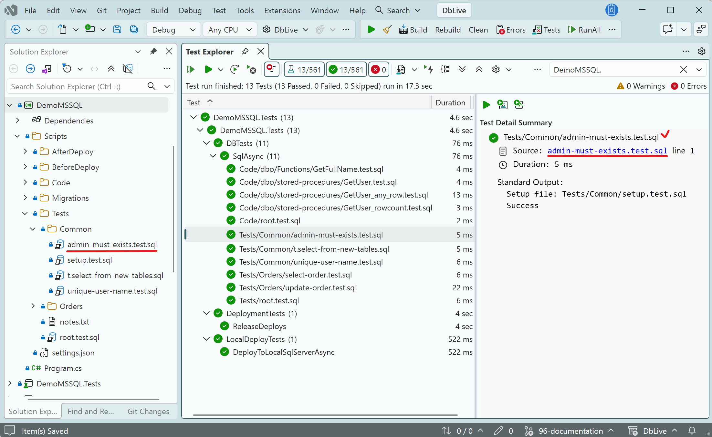

# Unit Testing

DbLive tests are plain `.sql` files with Arrange, Act and Assert sections. Every test runs inside a transaction that is **always rolled back**, so tests need no cleanup and can run again and again.

The tests run as normal xUnit tests in Visual Studio Test Explorer and in `dotnet test`, one test case per file (package `DbLive.xunit`). You need no shared test database: the test fixture deploys your scripts into a new database, in Docker (Testcontainers) or on a local server, runs the tests against it and drops it at the end. SQL tests then work like ordinary C# unit tests: every developer and every CI run gets the same database, built from the same scripts.

A deployment never runs the tests, so a production deployer does not. Without xUnit v2, run them all with one call ([Running all tests without xUnit](#running-all-tests-without-xunit)).

Tutorial: [Add a Stored Procedure and a Unit Test](stored-proc-and-unit-test.md).

## Where tests live

| Location | Which files are tests |
|----------|-----------------------|
| `Tests` and its subfolders | every `.sql` file except `setup.test.sql` |
| `Code` and its subfolders | files matching `TestFilePatterns`: `test.*.sql`, `t.*.sql`, `*.test.sql`, `*.t.sql` by default, except `setup.test.sql` |

Keep a test next to the object it tests (`Code/dbo/GetUser.sql` and `Code/dbo/GetUser.test.sql`). Use `Tests` for checks that span several objects or verify data rules.

## Anatomy of a test

```sql
-- Arrange
set identity_insert dbo.Users on;
insert into dbo.Users (UserId, Name) values (10, 'TestUser10');
set identity_insert dbo.Users off;

-- Act
exec dbo.GetUser @UserId = 10;

-- Assert
select assert = 'rows';
select 10 as UserId, 'TestUser10' as Name;
```

The **assert result set** is a result set whose first column is named `assert` (in any case). Its value chooses the assertion. Result sets returned **before** it are the actual results; result sets **after** it are the expected results. Statements that return no result set (`insert`, `set`, `declare`) are ignored.

A misspelled column (`select asstert = 'rows'`) or a missing alias (`select 'rows'`) does not silently turn the assertion off: the test fails with a message that names the column.

!!! warning "No `GO` in SQL Server test files"
    A test file is executed as a single batch, so `GO` is a syntax error there. `setup.test.sql`, migrations and code files may use `GO`.

## Assertions

| Assert | Passes when |
|--------|-------------|
| `rows` | There are as many actual result sets as expected ones, and each expected result set matches the actual result set at the same position: same column names (case-sensitive, character by character) in the same order, same number of rows, same values row by row. |
| `rows-with-schema` | Like `rows`, and the SQL column types match as well (for example `nvarchar(255)` vs `nvarchar(100)` fails, and `time(3)` vs `time(7)`; on PostgreSQL `timestamp(0)` vs `timestamp`). PostgreSQL returns the columns of a function without their length and precision (`varchar(50)` as `text`, `timestamp(0)` as `timestamp`), so cast the expected values of a function without them. A PostgreSQL domain is compared as its base type with the length or precision of the domain (a column of `create domain ts0 as timestamp(0)` is `timestamp(0)`), a SQL Server alias type as its base type. |
| `has-rows` | The first actual result set has at least one row. |
| `row-count=N` | There is exactly one actual result set, with exactly N rows. |
| `empty` | Shortcut for `row-count=0`. |
| `single-row` | Shortcut for `row-count=1`. |
| _(none)_ | The test passes if the script runs without an error. |

Only one assert result set is allowed per test. Assert values are case-insensitive.

### Custom checks

Without an assert result set, raise an error to fail the test:

```sql
-- SQL Server
declare @cnt int = (select count(*) from dbo.Users where Name = 'Admin');
if @cnt != 1 throw 50000, 'Expected one admin user.', 0;
```

```sql
-- PostgreSQL
do $$
begin
    if (select count(*) from users where name = 'Admin') != 1 then
        raise exception 'Expected one admin user.';
    end if;
end $$;
```

### How values are compared

`rows` compares each value by its JSON representation, and a failed test prints that text: `Expected values: null, 150.00, "test-user"`.

- `int` 10 and `bigint` 10 are equal.
- `decimal` values must have the same scale: `150.00` is not `150` and not `150.0`. Cast the expected value, for example `cast(150 as decimal(10,2))`.
- Strings are compared exactly, including case and trailing spaces.
- Compare a date or time value with a value of the same type, not with a string: cast the expected value, `cast('2026-01-01' as date)`. The text of a `date` differs by provider: `"2026-01-01T00:00:00"` on SQL Server, `"2026-01-01"` on PostgreSQL, where a `date` therefore never equals a `timestamp` at midnight. On PostgreSQL a `timestamptz` column equals only a `timestamptz` value.
- `NULL` equals `NULL` and nothing else.
- PostgreSQL `macaddr`, `macaddr8`, `inet`, `pg_lsn`, `tsquery`, `tsvector` and `path`, and SQL Server `geography`, `geometry` and `hierarchyid` (read with `Microsoft.SqlServer.Types`) are compared by their text. The text of an `inet` value has its netmask: `'192.168.0.1/24'::inet` differs from `'192.168.0.1/16'::inet`. A `tsvector` keeps its positions and weights, and an open `path` differs from the closed one.
- A value that cannot be compared fails the test with `Cannot compare the actual value of the column ...`: select it as text in the test.
- `NaN` and infinity of PostgreSQL `real` and `double precision` equal themselves.
- Some PostgreSQL values cannot be read, and fail the test whatever it asserts: `Cannot read the value of the column 'p' in row 1 of result set 1, of the type public.pair: ...`, then `Select the value as text in the test.` Such are a composite type (a column, or `select f()` of a function that returns one), the row of a table (`select u from users u`), `regclass` and the other `reg*` types but `regtype` and `regconfig`, `pg_snapshot`, a `numeric` `NaN` or infinity, an `interval` with months or years, a date after the year 9999. Select the value as text (`p::text`, `'users'::regclass::text`); a composite value also as its fields (`(p).*`, `select * from f()`), a `numeric` also as `float8`. An `aclitem` fails with `no binary output function available for type aclitem`: select it as text too.
- SQL Server `geography`, `geometry` and `hierarchyid` values cannot be read without the `Microsoft.SqlServer.Types` package in the test project: select `.ToString()` of the value instead.
- Row order matters; use `order by` in the act.
- Column names must match exactly. SQL Server gives an unnamed expression an empty name, so `select dbo.GetFullName('a', 'b')` can be compared with `select cast('a b' as nvarchar(255))`. PostgreSQL names such columns (`?column?` or the function name), so give both sides an alias.

!!! note "`rows` compares all actual output"
    `rows` fails on extra or missing result sets and rows, for example `Expected 1 row(s), but 3 received.` Every result set returned before the assert counts as actual, including output from the Arrange part (`update ... output`, a debugging `select`). Remove such output, or move the setup into `setup.test.sql`.

    On PostgreSQL a function called with `select` in the Arrange part returns a result set too, also a `void` function: `select add_user('x');` returns one row with `NULL`. `rows`, `row-count=N`, `empty` and `single-row` then fail on the extra result set, and `has-rows` checks that row and always passes. Call the function with `perform` in a `do` block, which returns nothing: `do $$ begin perform add_user('x'); end $$;`.

`row-count` counts rows of the actual result set: `select count(*) from dbo.Orders` returns **one** row. To check that there are three orders, select the orders themselves:

```sql
select OrderId from dbo.Orders;
select assert = 'row-count=3';
```

## Shared setup with `setup.test.sql`

A `setup.test.sql` file runs before **each** test in the same folder, inside the test's transaction. It works in `Tests` and in `Code`:

```text
Tests/
  Orders/
    setup.test.sql           inserts three orders
    select-orders.test.sql
    update-order.test.sql
Code/
  dbo/
    GetUser.sql
    GetUser.test.sql
    setup.test.sql           inserts test users
```

- It applies to tests in its own folder only, not to subfolders.
- It runs in the same transaction as the test, before it. Rows it inserts are visible to the test. Session state (temporary tables, variables, `SET` options) is not on SQL Server, where the test runs on a reset session and DbLive sets the isolation level of the test transaction before the test; on PostgreSQL the transaction is one session, and the test sees the temporary tables and settings of the setup. Use permanent tables: they work the same on both providers.
- It is never a test itself and never deployed as code, whatever `TestFilePatterns` contains.
- If it fails, the test does not run and fails with an error that names the setup file: `Setup file error (Tests/Orders/setup.test.sql): <error>`.

## Isolation and parallelism

- Each test runs in its own transaction with `TestsTransactionIsolationLevel` (default `Serializable`) and a timeout of twice `UnitTestItemTimeout` (default 1 minute). The transaction is rolled back after the assertion, whatever the result. A test or its `setup.test.sql` that runs longer than `UnitTestItemTimeout` fails with `ExecutionTimeoutException` on both providers: `Execution Timeout Expired. The script ran longer than its timeout of 00:01:00.` Each file has its own limit, so the two together may run up to twice `UnitTestItemTimeout`.
- A test must not end its transaction, and neither may the code it calls: see [Code that rolls back the transaction](#code-that-rolls-back-the-transaction).
- The [deployment test](deployment-tests.md) and `RunAllTestsAsync()` run all tests in parallel (`NumberOfThreadsForTestsRun`, default 10). Tests that write to the same tables under `Serializable` can deadlock; lower the thread count to 1 or use `ReadCommitted` if that happens.

### Code that rolls back the transaction

On SQL Server `ROLLBACK` without a savepoint name ends the transaction of the test, also inside a procedure the test calls. The usual error handler does it when the test catches the error:

```sql
begin catch
    if @@trancount > 0 rollback;
    throw;
end catch
```

`COMMIT` or `ROLLBACK` in a test or in `setup.test.sql` ends the transaction too, on PostgreSQL as well. DbLive compares the ID of the transaction before and after `setup.test.sql` and the test, and the test fails:

```text
The transaction of the test ended before the test did: the test, its setup.test.sql or the code they call ran ROLLBACK or COMMIT, ...
```

DbLive rolls back what ran after the end of the transaction, but what a `COMMIT` committed stays in the database: in the test database of `[SqlFact]` the other tests see it, and a database you test with `RunAllTestsAsync()` keeps it.

A procedure whose error path you test must not end a transaction it did not open. Inside a transaction of its caller it rolls back to a savepoint of its own:

```sql
create or alter proc dbo.AddOrder
    @Id int
as
begin
    declare @trancount int = @@trancount;
    begin try
        if @trancount = 0 begin transaction;
        else save transaction AddOrder;

        insert into dbo.Orders (Id) values (@Id);
        if @Id < 0 throw 50000, 'Id must be positive.', 1;

        if @trancount = 0 commit;
    end try
    begin catch
        -- a doomed transaction (xact_state() = -1) can only be rolled back as a whole
        if xact_state() = -1 or (xact_state() = 1 and @trancount = 0) rollback;
        else if xact_state() = 1 rollback transaction AddOrder;
        throw;
    end catch
end
```

An error that dooms the transaction (any run-time error with `XACT_ABORT ON`, a failed conversion) cannot be rolled back to a savepoint, so a test that catches such an error still fails.

On PostgreSQL a procedure cannot end the transaction of its caller: `ROLLBACK` or `COMMIT` in it fails with `invalid transaction termination`, and so does the test.

## Running tests in Visual Studio and CI (xUnit)

`DbLive.xunit` (xUnit v2) turns every SQL test file into an xUnit test case. For a new solution, `dotnet new dblive` creates the SQL project together with this test project, its fixture and both test classes ([Getting Started](../gettingstarted.md#with-the-template)). To add the tests to an existing SQL project, create a test project next to it (here `MyDb`) and reference it:

```bash
dotnet new xunit -n MyDb.Tests
dotnet add MyDb.Tests reference MyDb
dotnet add MyDb.Tests package DbLive.xunit
dotnet add MyDb.Tests package DbLive.Testcontainers.MSSQL   # SQL Server in Docker
```

- The `xunit` template adds `Microsoft.NET.Test.Sdk`, `xunit` and `xunit.runner.visualstudio`. `DbLive.xunit` works with xUnit v2, `xunit` 2.9.2 or later; if the template created an xUnit v3 project, switch it to the `xunit` 2.x package (2.9.3 is the last one). With an older `xunit` 2 the restore fails with `NU1107: Version conflict detected for xunit.extensibility.core`: update the `xunit` package rather than adding `xunit.extensibility.core` as the message suggests.
- For PostgreSQL in Docker, add `DbLive.Testcontainers.PostgreSQL`. To test against a server you run, add the provider package (`DbLive.MSSQL` or `DbLive.PostgreSQL`) instead and use its builder from the table below.

### 1. A fixture builder

The builder gives the fixture its database. Each builder takes the SQL project assembly and gives every fixture a new database with a random name (`DbLive--<guid>` on SQL Server, `dblive--<guid>` on PostgreSQL), so fixtures that run in parallel never share a database:

| Builder | Package (namespace `DbLive.MSSQL` / `DbLive.PostgreSQL`) | Database |
|---------|---------|----------|
| `MsSqlContainerFixtureBuilder(project, image?)` | `DbLive.Testcontainers.MSSQL` | SQL Server in Docker |
| `PostgreSqlContainerFixtureBuilder(project, image?)` | `DbLive.Testcontainers.PostgreSQL` | PostgreSQL in Docker |
| `MsSqlFixtureBuilder(project, connectionString)` | `DbLive.MSSQL` | A SQL Server you run |
| `PostgreSqlFixtureBuilder(project, connectionString)` | `DbLive.PostgreSQL` | A PostgreSQL server you run |

```csharp
// SQL Server in Docker
new MsSqlContainerFixtureBuilder(Assembly.Load("MyDb"))

// Without Docker, a local server; the database name in the connection string is replaced
new MsSqlFixtureBuilder(Assembly.Load("MyDb"), "Server=localhost;Database=master;Trusted_Connection=True;TrustServerCertificate=True;")
```

- `Assembly.Load("MyDb")` loads the SQL project by its assembly name, so the test project must reference it. A type from it works too: `typeof(MyDbMarker).Assembly`.
- The container builders start one container per test run with [Testcontainers](https://dotnet.testcontainers.org/). The first fixture starts it; fixtures that start at the same time wait for that start and share the container. Testcontainers removes it when the test run ends, unless its resource reaper is turned off (`TESTCONTAINERS_RYUK_DISABLED=true`, set on some CI runners). Docker must be running.
- The default images are `mcr.microsoft.com/mssql/server:2025-latest` and `postgres:18`. A new major version of the database engine in them comes only in a major DbLive release (see [Versioning](../versioning.md)). Pass another image as the second argument: `new PostgreSqlContainerFixtureBuilder(project, "postgres:17")`. Each image gets its own container.
- For a database set up in another way (a server from the configuration, a container with other options), implement `IDbLiveFixtureBuilder` (namespace `DbLive`). `GetBuilderAsync()` is called once per fixture and returns a new `DbLiveBuilder` with the provider, the connection string of a new database and the project; the fixture or the deployment test disposes it at the end, so never return a shared one. `GetProjectAssembly()` returns the SQL project assembly; test discovery reads the tests from it. The ready-made builders are a few lines each, for example [MsSqlFixtureBuilder](https://github.com/zacoders/DbLive/blob/main/src/DbLive.MSSQL/MsSqlFixtureBuilder.cs).

### 2. SQL tests: `[SqlFact]`

```csharp
using DbLive.MSSQL;
using DbLive.Testing;
using DbLive.xunit;
using System.Reflection;
using Xunit;
using Xunit.Abstractions;

public class MyDbTestFixture()
    : DbLiveTestFixture(new MsSqlContainerFixtureBuilder(Assembly.Load("MyDb")), dropDatabaseOnComplete: true);

public class SqlTests(ITestOutputHelper output, MyDbTestFixture fixture)
    : IClassFixture<MyDbTestFixture>
{
    [SqlFact(TestFixture = typeof(MyDbTestFixture))]
    public async Task Sql(string testFileRelativePath)
    {
        TestRunResult result = await fixture.Tester.RunTestAsync(output.WriteLine, testFileRelativePath);
        Assert.True(result.IsSuccess, result.ErrorMessage);
    }
}
```

- The fixture class must derive from `DbLiveTestFixture`, not be abstract and have a public parameterless constructor. Otherwise one failing test named after the test method says what is wrong and shows an example of a fixture.
- The fixture deploys the project once per test class (migrations, code and breaking changes, no tests) into a fresh database and drops it at the end if `dropDatabaseOnComplete` is true. The drop ends the sessions still open in the database, also the idle connections of the pool. On SQL Server it kills them first when the login may (`VIEW SERVER STATE` and `ALTER ANY CONNECTION`, as `sa` of a container); otherwise `single_user with rollback immediate` ends them, and the drop takes about 3 seconds longer.
- Each SQL file appears in Test Explorer under its relative path; "Go to source" opens the `.sql` file (it needs the project folder that the [DbLive package](../project/index.md#embedding-the-scripts) records in the SQL project's assembly).
- The tests read the scripts embedded in the SQL project's dll. Test Explorer and `dotnet test` build before running, so changed scripts are picked up; new test files appear after a build.
- An error in the project, for example a file outside the [project folders](../project/structure.md#folders), appears as one failing test named after the test method, "Exception during discovery", with the error.



### Deployment tests

`[SqlDeployFact]` deploys the project to an empty database the way production does (the release, the breaking phase, the breaking phase again) and checks that the second breaking deployment does not change the schema. It takes the same fixture builders: [Deployment Tests](deployment-tests.md).

## Running all tests without xUnit

`[SqlFact]` and `[SqlDeployFact]` need xUnit v2. With another test framework (NUnit, MSTest, xUnit v3), or to test a database that is already deployed, such as a local or a QA database, run all tests with the tester of a builder, for example in one test of your framework:

```csharp
DbLiveBuilder builder = new DbLiveBuilder()
    .SqlServer()
    .SetDbConnection(connectionString)
    .SetProject(typeof(MyDbMarker).Assembly);

await builder.CreateDeployer().DeployAsync(DeployParameters.Default);
await builder.CreateTester().RunAllTestsAsync();
```

`RunAllTestsAsync` does not deploy; against a database that is already deployed, leave out the `DeployAsync` line. Do not call it in a production deployer (see [Isolation and parallelism](#isolation-and-parallelism)).

### A test database without xUnit

DbLive does not drop a test database without xUnit: only the xUnit fixtures do.

**In Docker.** A container [fixture builder](#1-a-fixture-builder) gives the test a new database; it does not exist yet, so the deployment creates it. There is nothing to drop: Testcontainers removes the container when the test run ends.

```csharp
await using DbLiveBuilder builder = await new MsSqlContainerFixtureBuilder(typeof(MyDbMarker).Assembly).GetBuilderAsync();

await builder.CreateDeployer().DeployAsync(DeployParameters.Default with { CreateDbIfNotExists = true });
await builder.CreateTester().RunAllTestsAsync();
```

**On your own server.** Use a database with a fixed name, such as `MyDb_Tests`, and drop it with your own SQL **before** the deployment, so that every run deploys the whole project to an empty database. A database kept between runs gets only the new migrations and the changed code, and the deployment is not tested in full. Drop it before and not after: a run that fails halfway leaves the database behind, and the next run drops it anyway. `MsSqlFixtureBuilder` and `PostgreSqlFixtureBuilder` do not fit here: every call names a new database, which nothing drops without xUnit.

=== "SQL Server"

    ```csharp
    using DbLive;
    using DbLive.MSSQL;
    using Microsoft.Data.SqlClient;   // comes with DbLive.MSSQL

    const string connectionString = "Server=localhost;Database=MyDb_Tests;Trusted_Connection=True;TrustServerCertificate=True;";

    await using (SqlConnection master = new(connectionString.SetMsSqlDatabaseName("master")))
    {
        await master.OpenAsync();
        await using SqlCommand drop = new("""
            if db_id('MyDb_Tests') is not null
            begin
                alter database [MyDb_Tests] set single_user with rollback immediate;
                drop database [MyDb_Tests];
            end
            """, master);
        await drop.ExecuteNonQueryAsync();
    }
    SqlConnection.ClearPool(new SqlConnection(connectionString));

    await using DbLiveBuilder builder = new DbLiveBuilder()
        .SqlServer()
        .SetDbConnection(connectionString)
        .SetProject(typeof(MyDbMarker).Assembly);

    await builder.CreateDeployer().DeployAsync(DeployParameters.Default with { CreateDbIfNotExists = true });
    await builder.CreateTester().RunAllTestsAsync();
    ```

=== "PostgreSQL"

    ```csharp
    using DbLive;
    using DbLive.PostgreSQL;
    using Npgsql;   // comes with DbLive.PostgreSQL

    const string connectionString = "Host=localhost;Database=mydb_tests;Username=postgres;Password=...";

    await using (NpgsqlConnection postgres = new(connectionString.SetPostgreSqlDatabaseName("postgres")))
    {
        await postgres.OpenAsync();
        await using NpgsqlCommand drop = new("drop database if exists mydb_tests with (force);", postgres);
        await drop.ExecuteNonQueryAsync();
    }
    NpgsqlConnection.ClearPool(new NpgsqlConnection(connectionString));

    await using DbLiveBuilder builder = new DbLiveBuilder()
        .PostgreSQL()
        .SetDbConnection(connectionString)
        .SetProject(typeof(MyDbMarker).Assembly);

    await builder.CreateDeployer().DeployAsync(DeployParameters.Default with { CreateDbIfNotExists = true });
    await builder.CreateTester().RunAllTestsAsync();
    ```

A plain `drop database` fails while the database is in use, also by the connections that DbLive leaves in the connection pool: `set single_user with rollback immediate` on SQL Server and `with (force)` on PostgreSQL close them. `ClearPool` then removes the closed connections from the pool of the test database; without it, a second run in the same process fails on PostgreSQL with `57P01: terminating connection due to administrator command`. Do not call `ClearAllPools`: it clears the pools of the other tests in the process too.

On SQL Server, C# tests in the same process that connect with the same connection string can get a connection of DbLive from the pool at the isolation level of the last SQL test (`Serializable` by default): SQL Server does not reset the level of a pooled connection. Give DbLive another `Application Name` (see [A deployer](../deployment/index.md#a-deployer)).

Before the first test, `RunAllTestsAsync` checks the connection string and the database, and runs no test if a check fails:

- Connection pooling and enlistment are on, as by default. Otherwise `NotSupportedException` before any connection (see [A deployer](../deployment/index.md#a-deployer)).
- The database exists. Otherwise `DatabaseNotFoundException`, which names the database and the server.
- The DbLive tables exist. Otherwise `DatabaseNotDeployedException`: the project was never deployed there, or the connection string points to another database.
- The database does not require a newer DbLive. Otherwise `DatabaseRequiresNewerDbLiveException`: a newer DbLive has deployed it (see [The DbLive version a database requires](../deployment/index.md#the-dblive-version-a-database-requires)).
- The [ProjectId](../features/project-id.md) matches. The check only compares: with a `ProjectId` in `settings.json`, a database with another value or with none fails with `ProjectIdMismatchException`. A deployment of the project stores the value, so this stops only tests run against a database the project was not deployed to.
- The isolation levels in `settings.json` are supported by the database engine, as at the start of a deployment.

Each result goes to the log with the relative path of the test (`PASSED: Tests/Orders/select-orders.test.sql`, or `FAILED: ...` with the reason); nothing is saved in the database. If any test fails, `RunAllTestsAsync` throws `UnitTestsFailedException` after all tests have run, so the calling test fails and a console app exits with a non-zero code. Its message names the failed tests (the first ten); it has `FailedCount`, `TotalCount` and `FailedTests` (relative paths of all failed test files). The deployment was a separate call and stays committed.
